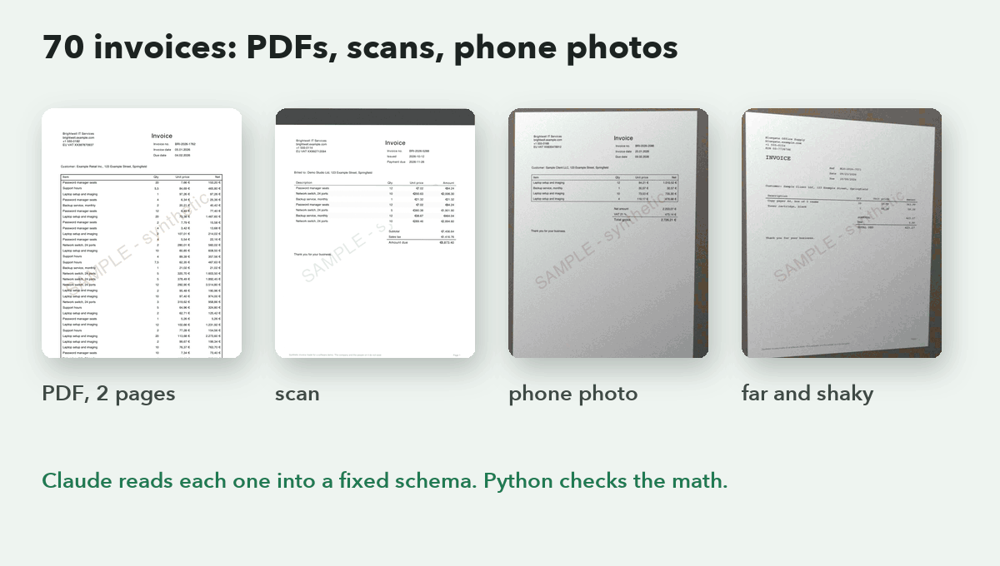

# Invoice extractor

[](https://github.com/diegoharroyo/invoice-extractor/actions/workflows/ci.yml)

Drop a folder of invoices (PDF, scan or phone photo) and get a Google Sheet: one row per invoice, the ones that
don't add up in orange, and the reason why. Claude reads each invoice; Python checks every line, subtotal, tax and
total. Claude is told to copy what is printed and never fix it; in the test no model corrected any of the 14
planted mistakes, so all of them stayed visible.

**In your version** nobody types a command: it runs on its own (say every morning, on the new invoices in a Gmail
label or Drive folder) and you open the Sheet and look at the orange rows. Invoices go only to Anthropic's API,
which doesn't train on API data by default, and to your own Google Sheet.

Tested on 70 synthetic invoices with three Claude models: how many misreads slipped through without a flag, and
what 1,000 invoices cost (US$ 0.87 to 28.50).



*The 70 invoices are synthetic, made by `make_invoices.py`: 4 layouts, USD and EUR, 2-page invoices, scans,
simulated phone photos (10 of them rough: taken from further away and shaky), and 14 with a planted mistake.
Claude's answers are saved in `recorded/`, so you can rerun everything below without an API key.*

## How well it reads

| Model | Invoices read perfectly | Field accuracy | Planted mistakes caught | False alarms | Misreads not flagged | Cost per 1,000 invoices | Median time |
|---|---|---|---|---|---|---|---|
| Haiku 5.5 | 64/70 | 98.1% | 14/14 | 3/52 | 1 of 6 misread | US$ 0.87 | 4 s |
| Sonnet 5.5 (default) | 65/70 | 99.0% | 14/14 | 1/53 | 2 of 5 misread | US$ 14.08 | 4 s |
| Opus 5.5 | 66/70 | 99.4% | 14/14 | 2/54 | 2 of 4 misread | US$ 28.50 | 6 s |

What the columns mean:

- **Invoices read perfectly:** every field and every line item matches what is printed (`samples/truth.json`).
- **Field accuracy:** vendor, invoice number, both dates, currency, subtotal, tax, total and the line items, where
  the whole item table counts as one field that is right only if every line is.
- **Planted mistakes caught:** invoices made wrong on purpose (a total that doesn't add up, a line where
  quantity × price is off, a due date before the invoice date, a duplicate) that ended up marked for review.
- **False alarms:** invoices with nothing wrong (no planted mistake, every field read right) marked for review
  anyway.
- **Misreads not flagged:** invoices Claude read wrong with nothing pointing at the mistake: it didn't say it
  couldn't read that field, and no check fails because of it. This is the number that matters: a flagged invoice
  gets a human look, anything else goes straight into your books.
- **Cost:** the tokens each invoice used, at Anthropic API list prices per million input/output tokens: Haiku
  US$ 0.10/0.50, Sonnet 2/10, Opus 4/20. One call per invoice, no caching.

Every misread was on the 10 rough photos. The other 60 files (PDFs, scans, ordinary phone photos, 2-page
invoices) were read perfectly by all three models. On the rough photos: Haiku got 86.7% of fields right,
Sonnet 93.3%, Opus 95.6%.

Across the three models Claude misread 15 invoices and flagged the right field in 10. The 5 it didn't:

- **Haiku, invoice_69:** dropped the period from "Kestrel Cleaning Co." It also misread the invoice number, but
  that one it marked as hard to read.
- **Sonnet and Opus, invoice_62:** read the due date 08/12/2026 as 09/12/2026. The wrong date is still
  plausible, so no check can catch it. See [Limits](#limits).
- **Sonnet and Opus, invoice_63:** got one digit of the invoice number wrong. The invoice went to review for
  its planted total mistake, but nothing pointed at the number.

Choosing a model:

- **Haiku** costs a sixteenth of Sonnet. It says "hard to read" more often, so it raised the most false alarms
  (two rough photos, and invoice_02, whose date 07/02/2026 can be July 2 or February 7). Good for volume, if
  your team doesn't mind a few more orange rows.
- **Sonnet** is the default: the fewest false alarms (1, against Haiku's 3), and 93.3% of fields right on the
  rough photos against Haiku's 86.7%.
- **Opus** read the most fields right, at twice Sonnet's price.
- With 70 invoices, a difference of one or two invoices between models is noise. Run `eval.py` on a sample of
  your own before choosing.

The answers were recorded through the `claude` CLI, with the same prompt and schema as `ask_api`. Token counts are
the ones the CLI reported, and it wraps each request in a little of its own, so a direct API call should use
somewhat fewer input tokens and cost a bit less. Times include the CLI's start-up, so the API should be faster too.

Rerun the tables with `uv run eval.py` (it only reads `recorded/`, it never calls Claude).

## What it does

- Reads every `.pdf`, `.png`, `.jpg`/`.jpeg` and `.webp` in a folder, and names any other file it skipped. PDFs go
  to Claude as documents, scans and photos as images. Photos over 3.5 MB or 8000 px are scaled down first (the API
  takes images up to 5 MB and 8000 px), and photos the phone marked as rotated are turned upright.
- Claude fills a fixed schema (Pydantic): vendor, invoice number, dates, currency, line items, subtotal, tax,
  total, plus the fields it couldn't read with confidence.
- Python checks each invoice: quantity × unit price = amount on every line, lines add up to the subtotal,
  subtotal + tax = total, due date not before the invoice date, a 3-letter currency code, no duplicate in
  the batch (same invoice number from the same vendor, or with the same total; invoices without a number aren't
  compared).
- Writes an **Invoices** tab (one row each, status, reason, the ones to review in orange) and a **Line items**
  tab to your Google Sheet, and the same as `invoices.csv` and `line_items.csv`.
- Saves each answer in `answers/` (git-ignored) under the file's hash, with the model, the prompt version,
  tokens, cost and time. The same file is not paid for twice, even renamed, and every number in the sheet can be
  traced back.
  The answers behind this README are in `recorded/`, one JSON per file, named by its hash (the file name is inside).
- Text stays text: an invoice number like `0012` doesn't turn into 12, and text that starts like a formula (`=`,
  `+`, `-`, `@`) is not run as one, so a hostile invoice can't put a formula in your sheet.
- One bad file doesn't stop the batch: it shows up as `failed` with the error, and the script exits with 1 so a
  scheduled run notices. So does an output it couldn't write (a CSV open in Excel, a Sheet that went away); the
  other one is still written. The Sheet is opened before the first invoice is read, so a bad key file or a sheet
  that isn't shared stops the run before anything is paid for.

## Run it

You need [uv](https://docs.astral.sh/uv/).

```sh
uv sync
uv run extract.py samples --offline --recorded recorded   # the recorded answers: no key, no cost
uv run eval.py                                            # the tables above
```

To read your own invoices, copy `.env.example` to `.env`, add an
[Anthropic API key](https://console.anthropic.com/), and run:

```sh
uv run --env-file .env extract.py path/to/invoices
```

It prints what it did, e.g. `{"files": 70, "needs_review": 18, "failed": 0, "skipped": 1, "spent_usd": 0.99}`
(the skipped file in `samples/` is `truth.json`).
For the Google Sheet, also set `GOOGLE_CREDENTIALS` (a service-account JSON file) and `SHEET_ID`
(the long id in the sheet's URL), and share the sheet with the service account's email.

`uv run --group gen make_invoices.py` rebuilds `samples/` (it needs `pdftoppm` and ImageMagick for the scans and
photos).

## Adapt it to your invoices

- **Other fields** (PO number, VAT id, bank details): add them to `Invoice` in `extract.py` and to the sheet
  columns. Claude fills whatever the schema asks for.
- **Your own rules** (approved vendors, amount limits, matching against purchase orders): add a line to `check()`.
  It returns the reasons an invoice needs a look; the rest of the pipeline already handles them.
- **Where the invoices come from:** the script reads a folder. In front of it goes the step that fills the
  folder: Gmail API access to your account and a label to watch (or a Drive folder, or an upload form), saving
  each PDF or image attachment. That part is built per client and is not in this demo.
- **Volume:** files run one at a time. For a backlog, the Message Batches API halves the price (Sonnet about
  US$ 7 per 1,000) if you can wait up to 24 hours. The SDK already retries rate limits and server errors. The
  prompt is too short for prompt caching to save anything.
- **Which model:** `--model claude-haiku-5-5` for the cheapest run. Measure on a sample of your own invoices
  first: write a `truth.json` for 20 or so of them by hand, run `extract.py` on them with each model, and
  `uv run eval.py path/to/invoices --recorded answers` gives you the same table for your documents.

## Limits

- Handwritten invoices are not in this test set. Bad photos are, and that's where every misread happened: ask
  for a closer, steadier photo when a row comes back "hard to read".
- The phone photos are simulated (rendered invoices given perspective, blur, noise and JPEG artifacts in
  software), not taken with a phone. HEIC photos need converting to JPG first; most phones send JPG when you
  share or email a photo.
- Every file is assumed to be an invoice. A statement, quote or receipt in the folder is read as one, and since the
  schema requires an invoice date and a total, a document without them gets a guess. If your files can lack them,
  make those fields optional in `Invoice` and add a check for the empty ones.
- The checks assume lines → subtotal → plus one tax → total. Discounts or fees below the subtotal, several VAT
  rates, tax-inclusive line prices, unit prices rounded to 2 decimals on the invoice, or flat-fee lines with no
  quantity will raise false alarms until `check()` and the schema know about them.
- Each run replaces what's in the sheet, and duplicates are caught within one batch only. For ongoing use, adding
  rows under the last batch is a few lines in `to_sheet()`, and checking against every earlier invoice a few in
  `check()`.
  Two invoices with the same number but a vendor name and total that both differ (say "Acme" and "Acme Inc.", a
  different amount) are not seen as duplicates.
- The checks catch numbers that don't add up. A misread that still adds up (the right digits in the wrong field,
  or a vendor name read wrong) is only caught if Claude says it couldn't read it, so keep a person reviewing
  the orange rows and spot-checking the rest.
- Only files are read. An invoice that arrives as the email body or behind a "View invoice" link (Stripe,
  QuickBooks, utility portals) has to be saved as a PDF first, a separate step.
- One currency per invoice; no conversion.
- Invoices are sent to Anthropic's API to be read. Check that this fits your data policy.

## Tests

```sh
uv run pytest
uv run ruff check .
```

The checks run on hand-made invoices with one mistake each, on the planted mistakes in `samples/`, and on a full
offline run of all 70 files. `ask_api` and the Sheet are tested against stand-ins for the Anthropic and Google
clients, big photos against the 5 MB limit, and formula-looking text against ending up as a formula. Nothing calls
Claude, so CI runs on every push.

---

MIT license.
